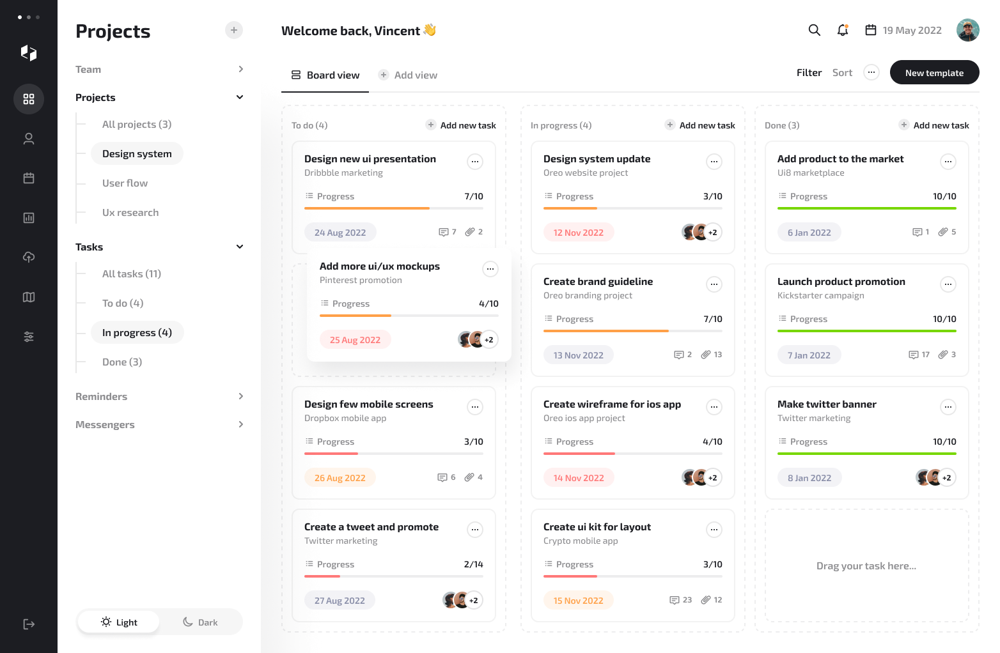

# 7. Thiết kế giao diện

**Nguồn tham khảo:** [To do list dashboard (Freebie) — Figma Community](https://www.figma.com/design/jbGZd3XujyfeEyqbCJJOxL/To-do-list-dashboard--Freebie---Community-?node-id=0-1)
**Ảnh chụp:** [ui-reference/light-mode.png](ui-reference/light-mode.png) · [ui-reference/dark-mode.png](ui-reference/dark-mode.png)

Design gồm 1 màn hình **Kanban board** (3 cột To do / In progress / Done), có cả Light và Dark mode, kích thước 1564 × 1022.



## 7.1 Bố cục

```
┌────┬──────────────┬──────────────────────────────────────────────────┐
│ 90 │   ~318px     │ Header: lời chào · tìm kiếm · 🔔 · ngày · avatar   │
│ px │              ├──────────────────────────────────────────────────┤
│    │ Panel phụ    │ Tabs: Board view | + Add view   Filter Sort ⋯ [New template] │
│ Icon│ (Projects,  ├────────────────┬────────────────┬────────────────┤
│ nav│  Tasks,      │ To do (4)   +  │ In progress (4)│ Done (3)    +  │
│    │  Reminders…) │ ┌────────────┐ │ ┌────────────┐ │ ┌────────────┐ │
│    │              │ │ Task card  │ │ │ Task card  │ │ │ Task card  │ │
│    │ [Light|Dark] │ └────────────┘ │ └────────────┘ │ └────────────┘ │
└────┴──────────────┴────────────────┴────────────────┴────────────────┘
```

- **Thanh icon** (90px, luôn tối `#1c1d22` ở cả 2 mode): logo, 8 icon điều hướng, nút đăng xuất ở dưới.
- **Panel phụ**: tiêu đề lớn, các nhóm có thể thu gọn (Team, Projects, Tasks, Reminders…), mục đang chọn có nền dạng viên thuốc (pill). Công tắc Light/Dark ở dưới cùng.
- **Header**: lời chào, icon tìm kiếm, chuông thông báo (có chấm cam khi có thông báo mới), ngày hôm nay, avatar.
- **Thanh công cụ**: tab view (gạch chân khi chọn), Filter, Sort, nút `⋯`, nút chính **New template**.
- **Board**: 3 cột, mỗi cột có tiêu đề + số lượng + nút "Add new task"; vùng thả có viền nét đứt "Drag your task here…".

## 7.2 Thẻ task (Task card)

```
┌────────────────────────────────────────┐
│ Design new ui presentation        (⋯)  │  ← tiêu đề 16 Bold + nút more tròn
│ Dribbble marketing                     │  ← dòng phụ (dự án), 50% opacity
│                                        │
│ ☰ Progress                       7/10  │
│ ████████████████░░░░░░░                │  ← thanh tiến độ
│                                        │
│ (24 Aug 2022)            💬 7   📎 2   │  ← chip ngày + bộ đếm / avatars
└────────────────────────────────────────┘
```

**Màu chip ngày (theo độ gấp của hạn):**
| Trạng thái | Nền | Chữ |
|---|---|---|
| Bình thường | `#888da7` 10% | `#888da7` |
| Sắp đến hạn | `#ffa048` 10% | `#ffa048` |
| Rất gấp / quá hạn | `#ff7979` 10% | `#ff7979` |

**Màu thanh tiến độ:** `#ff7979` (thấp) · `#ffa048` (trung bình) · `#78d700` (hoàn thành).

Thẻ đang được kéo: nổi lên, có bóng đổ, chỗ cũ để lại khung nét đứt.

## 7.3 Design tokens

> Bảng dưới là token của **design gốc trên Figma**. App hiện dùng tông pastel hồng – đào, font Nunito và mascot mèo — xem [7.7](#77-giao-diện-mèo-cute).

### Font
**Exo 2** (Google Fonts, có hỗ trợ tiếng Việt — kiểm tra lại dấu khi dựng UI).

| Vai trò | Cỡ | Độ đậm |
|---|---|---|
| Tiêu đề panel ("Projects") | 30px | Bold 700 |
| Lời chào header | 20px | Bold 700 |
| Tiêu đề thẻ task | 16px | Bold 700 |
| Menu, tab, tiêu đề cột | 14–16px | SemiBold 600 |
| Dòng phụ, chip, bộ đếm | 13–14px | Medium 500 |

Line-height ≈ 100% cỡ chữ (design rất chặt — khi code nên nới lên ~1.25 cho tiếng Việt có dấu).

### Màu

| Token | Light | Dark |
|---|---|---|
| `bg-app` (nền vùng board) | `#ffffff` (panel phụ `#fafafa`) | `#2a2b2f` |
| `bg-sidebar` (thanh icon) | `#1c1d22` | `#1c1d22` |
| `bg-panel` (panel phụ) | `#ffffff` + bóng đổ | `#222327` |
| `bg-column` | `#ffffff`, viền nét đứt `#1c1d22` 8% | `#24262c` |
| `bg-card` | `#ffffff`, viền `#1c1d22` 6% | `#292b31` |
| `text-primary` | `#1c1d22` | `#ffffff` |
| `text-secondary` | `#1c1d22` 50% | `#ffffff` 50% |
| `border` | `#1c1d22` 8–10% | `#ffffff` 10% |
| `track` (nền thanh tiến độ) | `#1c1d22` 8% | `#ffffff` 10% |
| `btn-primary` | `#1c1d22` / chữ trắng | `#4b69ff` / chữ trắng |
| `muted` (chip ngày thường) | `#888da7` | `#989caa` |
| `danger` | `#ff7979` | `#ff7979` |
| `warning` | `#ffa048` | `#ffa048` |
| `success` | `#78d700` | `#78d700` |

### Hình khối (ước lượng từ ảnh)
- Bo góc: thẻ & cột ~12px; chip ngày, nút, mục menu đang chọn: bo tròn hoàn toàn (pill).
- Padding nút chính: 12px × 24px. Padding chip ngày: 8px × 16px.
- Khoảng cách giữa các thẻ ~16px; padding trong thẻ ~20px.

## 7.4 Áp dụng vào app của mình

Design này khớp khá tốt với plan. Những gì **giữ nguyên**, **đổi nghĩa** và **cần thêm**:

| Thành phần trong design | Trong app Workbench |
|---|---|
| Cột To do / In progress / Done | ✅ Giữ — chính là `status` của task (`CANCELLED` ẩn khỏi board) |
| Nút **New template** | ✅ Giữ — mở trình tạo **form mẫu** (tính năng chính) |
| Nút "Add new task" mỗi cột | ✅ Giữ — tạo nhanh 1 task, status = cột đó |
| Chuông thông báo + chấm cam | ✅ Giữ — danh sách nhắc nhở đã gửi, chưa đọc |
| Kéo thả thẻ giữa các cột | ✅ Giữ — đổi status (thư viện `dnd-kit`) |
| Light / Dark mode | ✅ Giữ |
| Tab "Board view" / "Add view" | 🔁 Board view + **List view** (MVP), Calendar view (sau) |
| Dòng phụ trên thẻ (tên dự án) | 🔁 Tên **template** đã sinh ra task, hoặc tag |
| Progress 7/10 | 🔁 Số **task con** đã xong / tổng (ẩn nếu không có task con) |
| Chip ngày xám/cam/đỏ | 🔁 Theo **hạn chót**: xám = còn > 24h · cam = < 24h · đỏ = quá hạn |
| Panel phụ: Projects | 🔁 **Templates** (danh sách form mẫu, bấm để điền form) |
| Panel phụ: Tasks (All / To do / …) | 🔁 Bộ lọc nhanh: **Hôm nay · Quá hạn · 7 ngày tới · Tất cả** |
| Panel phụ: Reminders | 🔁 Trang lịch nhắc sắp tới |
| Avatar + lời chào trên header | ✅ Giữ — tên và avatar người dùng đang đăng nhập; bấm avatar mở menu Hồ sơ / Cài đặt / Đăng xuất |
| Nút đăng xuất cuối thanh icon | ✅ Giữ |
| Avatars trên thẻ, 💬 comment, 📎 đính kèm | ❌ Bỏ trong MVP (mỗi người chỉ thấy task của mình) — thay bằng **badge ưu tiên** và icon 🔔 số lần nhắc còn lại. Avatars dùng lại khi có làm việc nhóm |
| Team, Messengers | ❌ Bỏ trong MVP — Team dùng lại khi có làm việc nhóm |
| — (design không có) | ➕ **Badge ưu tiên** trên thẻ |
| — | ➕ Màn hình **điền form mẫu** + xem trước task |
| — | ➕ Màn hình **chi tiết task**, **Cài đặt thông báo** |

### Hiển thị mức ưu tiên

Design dùng đỏ/cam cho cả chip ngày lẫn thanh tiến độ, nên nếu ưu tiên cũng dùng đỏ/cam thì thẻ sẽ rối. Đề xuất:

- **Badge ưu tiên** ở góc trên thẻ (cạnh nút ⋯): icon cờ + chữ, dùng bảng màu riêng:
  | Mức | Màu |
  |---|---|
  | Khẩn cấp | `#ff4d4f` (nền 10%) |
  | Cao | `#ffa048` (nền 10%) |
  | Trung bình | `#4b69ff` (nền 10%) |
  | Thấp | `#888da7` (nền 10%) |
- **Thanh tiến độ** đổi sang 1 màu trung tính `#4b69ff`, chỉ chuyển `#78d700` khi xong 100% — để màu đỏ/cam chỉ mang nghĩa "gấp".
- Trong mỗi cột, thẻ được sắp xếp mặc định: ưu tiên cao → hạn gần.

## 7.5 Các màn hình cần thiết kế thêm (design gốc không có)

1. **Điền form mẫu** — dialog/side panel: chọn template → các trường form → danh sách task xem trước → nút "Tạo N task".
2. **Trình tạo template** — 2 phần: danh sách trường form, danh sách quy tắc task (tiêu đề có biến `{{...}}`, hạn tương đối, ưu tiên).
3. **Chi tiết task** — side panel trượt từ phải khi bấm vào thẻ.
4. **List view** — bảng: ưu tiên · tiêu đề · hạn · trạng thái · template.
5. **Cài đặt** — kênh thông báo, lịch nhắc theo ưu tiên, giờ yên lặng.
6. **Đăng nhập** — bố cục 2 nửa: bên trái nền `#1c1d22` có logo + ảnh minh hoạ board, bên phải tên app + một nút pill "Đăng nhập bằng Google" (logo Google theo đúng [quy định thương hiệu của Google](https://developers.google.com/identity/branding-guidelines)). Có thông báo lỗi khi email không nằm trong danh sách được phép.
7. **Hồ sơ** — tên, avatar (từ Google), múi giờ, thẻ "Kết nối Telegram" (trạng thái, @username, nút Kết nối / Ngắt kết nối).
8. **Quản trị** — bảng người dùng, danh sách email / tên miền được phép, cảnh báo nếu thiếu cấu hình Telegram.

Các màn hình này dùng lại đúng token và thành phần ở trên (pill, chip, card, nút đen/xanh) để đồng bộ.

## 7.6 Lưu ý bản quyền

Đây là file Freebie trên Figma Community. Trước khi dùng thật nên xem lại giấy phép trên trang Community của file (thường là CC BY 4.0 — cho phép dùng, cần ghi nguồn tác giả).

## 7.7 Giao diện mèo cute

Bố cục giữ nguyên như design gốc; đổi màu, font và thêm mascot mèo cam.

**Font:** Nunito (Google Fonts, có tiếng Việt), nét tròn mềm.

**Màu** (khai báo trong `frontend/src/app/globals.css`):

| Token | Light | Dark | Dùng cho |
|---|---|---|---|
| `bg-app` | `#fff8f3` (kem) | `#2b2124` | nền vùng board |
| `bg-panel` | `#fff1ea` | `#241b1e` | panel phụ |
| `bg-card` | `#ffffff` | `#362a2e` | thẻ task |
| `bg-sidebar` | `#3b2a2f` (nâu cacao) | `#1f1619` | thanh icon |
| `text-fg` | `#3b2a2f` | `#fff3ee` | chữ chính |
| `bg-primary` / `text-on-primary` | `#c93c64` / trắng | `#ff8fa6` / `#2b1d21` | nút chính |
| `brand` | `#c93c64` | `#ff8fa6` | link, nhấn, thanh tiến độ |
| `blush` | `#ffd6df` | `#5a3640` | nền tròn icon cột, icon form mẫu |
| `calm` | `#3f63f0` | `#8aa0ff` | mức ưu tiên Trung bình (tách khỏi hồng/đỏ để không nhầm với Khẩn cấp) |
| `pink` | `#ff8fa6` | `#ff8fa6` | mục đang chọn ở thanh icon, dấu chấm thông báo |

Chữ trên nền đều đạt tương phản WCAG AA (≥ 4.5:1), riêng `danger` / `warning` giữ như cũ.

**Mascot** (`frontend/src/components/cats.tsx`): SVG tự vẽ, không dùng ảnh ngoài nên không lo bản quyền; màu mèo cố định để giống nhau ở 2 chế độ.

| Thành phần | Ở đâu |
|---|---|
| `Logo` — mặt mèo | thanh icon, trang đăng nhập, favicon (`src/app/icon.svg`) |
| `PawPrint` — dấu chân | thanh icon, chân trang đăng nhập, nền trang đăng nhập (`.paw-pattern`) |
| `PeekingCat` — mèo ló đầu | trên bảng minh hoạ trang đăng nhập, trên nút Sáng/Tối của panel |
| `SleepingCat` / `EmptyState` — mèo ngủ | cột trống, danh sách trống, chưa có form mẫu, chưa có thông báo |
| `CatInBox` — mèo trong thùng | trang 404 |
| `SittingKitten` (`components/kitten.tsx`) — bé mèo mướp xám mắt xanh, ảnh tĩnh | thẻ **mèo nhắc việc** (`components/cat-reminder.tsx`), thẻ Cài đặt |

**Mèo nhắc việc:** thỉnh thoảng bé mèo mướp (ảnh tĩnh — không chuyển động) hiện ở góc dưới phải, lời nhắc nằm trong
bong bóng thoại ngay trên đầu mèo (đuôi bong bóng chỉ xuống giữa đầu mèo) — task quá hạn (ưu tiên cao nhất trước) hoặc task đến hạn trong 24 giờ; nút **Xem ngay** (mở task) / **Để sau**
(2 giờ nữa mới hiện lại); không ai bấm thì 25 giây sau tự ẩn. Hiện sớm nhất 8 giây sau khi mở app, cách nhau ≥ 45 phút,
chỉ khi tab đang mở và không có hộp thoại. Bật / tắt và "Gọi mèo ra ngay" ở **Cài đặt** — lưu trong `localStorage`
của từng thiết bị.

Mèo ngủ thở nhẹ, mèo ló đầu lắc lư; chuyển động tự tắt khi hệ điều hành bật "giảm chuyển động" (`prefers-reduced-motion`). Tiêu đề cột có emoji: 🧶 Cần làm · 🐈 Đang làm · 😸 Hoàn thành.
